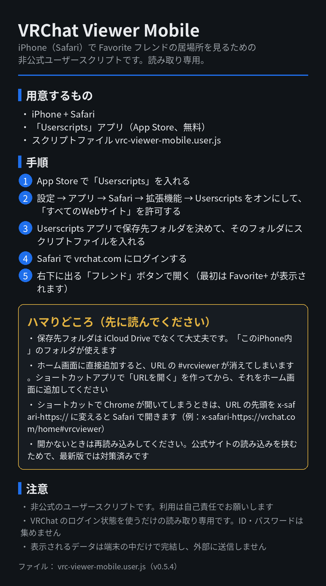

# VRChat Viewer Mobile（非公式ユーザースクリプト）

iPhone（Safari）で VRChat の Favorite フレンドの居場所を確認するための、読み取り専用のユーザースクリプトです。Chrome 拡張機能版の「Favorite+」相当の表示をスマホ向けにしたもので、VRChat のログイン状態を使うだけです。ID・パスワードを集めることはありません。

導入方法は下の画像の通りです。利用は自己責任でお願いします。

- ファイル: [vrc-viewer-mobile.user.js](vrc-viewer-mobile.user.js)
- 動作確認: iPhone SE（第3世代）+ Safari + Userscripts アプリ
